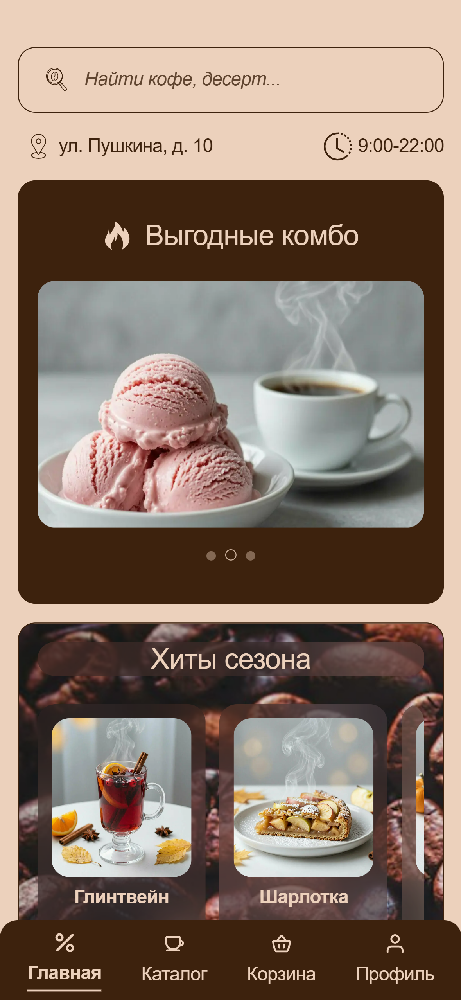
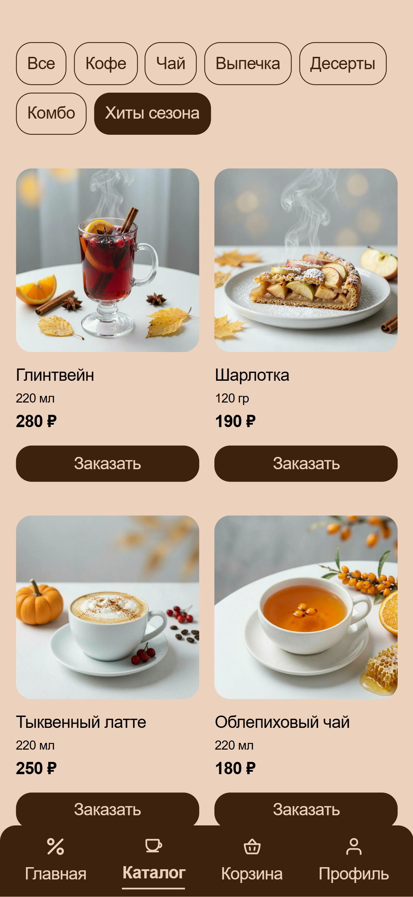
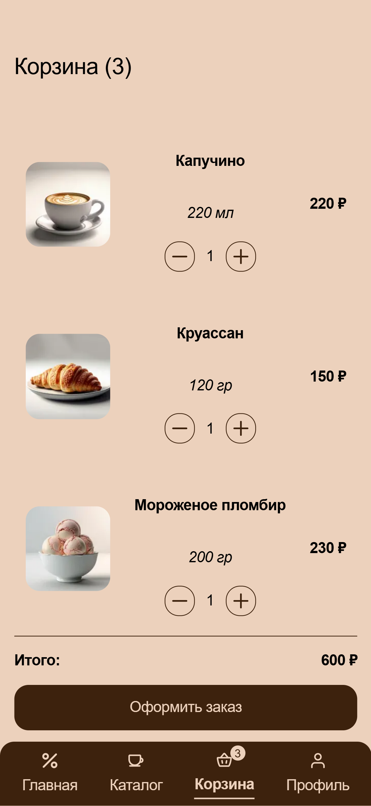
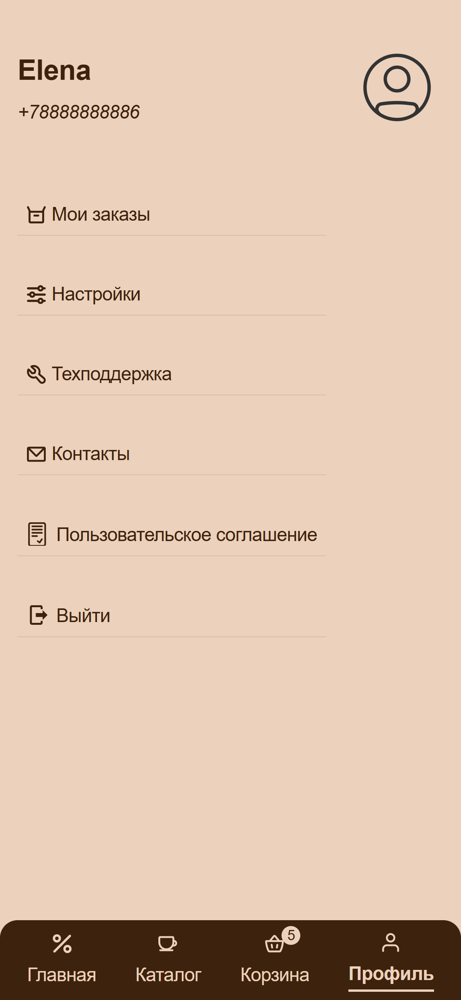

# Coffee Owl

PWA coffee shop app for ordering coffee without waiting in line.

## Links

- [Demo on Vercel](https://coffee-owl-peach.vercel.app/)
- [GitHub Repository](https://github.com/PlayerFront/coffee-owl)

## About the project

Coffee Owl is a Progressive Web App (PWA) that allows you to:
- Order coffee and desserts in 30 seconds
- Choose a convenient pickup time
- View order history
- Install the app on your phone like a native app

## Screenshots
   

## Tech Stack

- **React 19** — UI library
- **JavaScript** — language
- **SCSS** — styling (BEM)
- **Supabase** — database and authentication
- **Swiper.js** — carousels
- **React Hook Form** — forms
- **Jest + React Testing Library** — tests
- **PWA** — Service Worker, phone installation
- **Vercel** — deployment

## Features

### Authentication
- Sign in and sign up by phone number
- Code confirmation (SMS simulation: code `1234` is printed to the console)
- Form validation
- Session persistence

### Catalog
- Products with filters (Coffee / Tea / Pastry / Desserts / Combos / Seasonal)
- Strikethrough prices on combos
- Add to cart with quantity

### Cart
- Manage item quantities
- Total price
- Checkout modal

### Checkout
- Pickup time selection (slots 9:00–21:30)
- Payment method selection (cash / card)
- Nice order number (`CWL-XXXXX`)
- Success screen with checkmark
- Saving to Supabase

### Profile
- Order history with dates
- Settings (name, email, date of birth)
- Support with FAQ and feedback form
- Coffee shop contacts with map
- User agreement

### Home
- Search with debounce
- Popular combos carousel
- Seasonal offers with add to cart
- Coffee shop load chart
- Address and working hours

### PWA
- Service Worker with caching
- Phone installation (Android / iOS)
- iOS install guide modal

## Security (learning project)

RLS is enabled, but policies use `true` — this is a temporary solution for demonstration purposes.
Real protection requires **Supabase Auth** with policies based on `auth.uid()`.

**Current state:**
- RLS is enabled on `users` and `orders` tables
- Policies allow anonymous access (to support authentication simulation)
- Data in the project is test data

**In production:**
- Switch to Supabase Auth
- Use `auth.uid() = user_id` in policies
- Restrict SELECT/UPDATE/INSERT to own data only

## Installation and Launch

```bash
# Clone the repository
git clone https://github.com/PlayerFront/coffee-owl.git

# Install dependencies
npm install

# Create .env file
REACT_APP_SUPABASE_URL=your_supabase_url
REACT_APP_SUPABASE_ANON_KEY=your_supabase_anon_key

# Start the dev server
npm start

# Build the production version
npm run build

# Run tests
npm test
